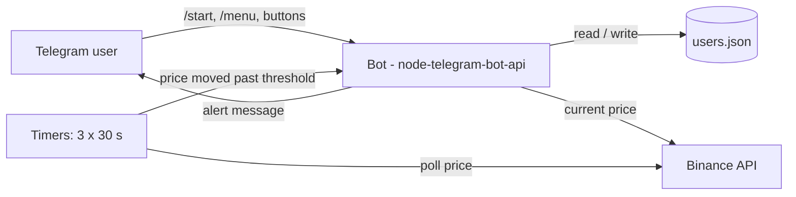

# Crypto Price Alert Bot for Telegram

A lightweight Telegram bot written in Node.js that watches cryptocurrency prices on Binance and notifies subscribed users when a price moves significantly. Users can also request the current price of any supported coin on demand, and each user chooses which coins they want alerts for through an inline-keyboard menu.

- **Supported coins:** Bitcoin (BTC), Ethereum (ETH), Gram (GRAM) — all quoted in USDT
- **Data source:** Binance public REST API (no API key required)
- **Storage:** a single JSON file, no database needed
- **Footprint:** three runtime dependencies, about 300 lines of code

---

## Table of Contents

- [Features](#features)
- [How It Works](#how-it-works)
- [Tech Stack](#tech-stack)
- [Project Structure](#project-structure)
- [Getting Started](#getting-started)
- [Usage](#usage)
- [Configuration](#configuration)
- [Alert Logic in Detail](#alert-logic-in-detail)
- [Data Storage](#data-storage)
- [Contributing](#contributing)

---

## Features

- **On-demand prices** — fetch the current BTC, ETH or GRAM price with two taps.
- **Automatic price-change alerts** — the bot polls Binance every 30 seconds and broadcasts a message when a price moves past a per-coin threshold.
- **Per-user subscriptions** — every user can switch alerts on or off for each coin independently. The button shows the current state (🟢 on / 🔴 off) and updates in place.
- **Zero-config onboarding** — sending `/start` registers the user with all coins enabled.
- **Self-cleaning user list** — users who block the bot or whose chat no longer exists are removed automatically the first time a delivery fails.
- **Inline keyboard UI** — navigation happens by editing and sending inline buttons, so users never have to type coin names.

## How It Works



1. `index.js` loads environment variables and calls `startBot()`.
2. `telegram.js` creates the bot in long-polling mode, registers the commands, and handles every inline-button press in a single `callback_query` handler.
3. Three independent `setInterval` timers (one per coin) call that coin's `check…Price` function every 30 seconds.
4. Each checker fetches the latest price from Binance, compares it with the last baseline price, and, if the change is large enough, sends a message to every user subscribed to that coin.
5. User preferences live in `users.json`, managed by the helpers in `users.js`.

## Tech Stack

| Component | Purpose |
|---|---|
| [Node.js](https://nodejs.org/) (CommonJS modules) | Runtime |
| [`node-telegram-bot-api`](https://github.com/yagop/node-telegram-bot-api) `^0.66.0` | Telegram Bot API client (long polling) |
| [`axios`](https://axios-http.com/) `^1.20.0` | HTTP requests to the Binance API |
| [`dotenv`](https://github.com/motdotla/dotenv) `^17.4.2` | Loads `BOT_TOKEN` from `.env` |

## Project Structure

```
crypto-bot/
├── index.js          # Entry point: loads .env and starts the bot
├── telegram.js       # Bot setup, commands, inline menus, callback handling, timers
├── users.js          # Reading and writing user preferences (users.json)
├── crypto/
│   ├── bitcoin.js    # BTC: price fetching + change detection + broadcasting
│   ├── ethereum.js   # ETH: same structure as bitcoin.js
│   └── gram.js       # GRAM: same structure, higher alert threshold
├── users.json        # Runtime data, created automatically (git-ignored)
├── .env              # Secrets, e.g. BOT_TOKEN (git-ignored)
├── package.json
└── package-lock.json
```

### Module responsibilities

**`telegram.js`**
Creates the `TelegramBot` instance, sets the command list (`/start`, `/menu`), builds all menus, and routes button presses with a `switch` on `callback_data`. It also starts the three polling timers. After each press it calls `answerCallbackQuery` so Telegram stops showing the loading spinner on the button.

**`crypto/<coin>.js`**
Each coin module exports two functions:

| Function | Description |
|---|---|
| `get<Coin>Price()` | Calls `GET /api/v3/ticker/price?symbol=<COIN>USDT` on Binance and returns the price as a string rounded to two decimals. |
| `check<Coin>Price(bot)` | Compares the current price with the stored baseline and broadcasts an alert to subscribed users when the threshold is crossed. |

**`users.js`**
A small persistence layer on top of `users.json`:

| Function | Description |
|---|---|
| `loadUsers()` | Reads and parses the file; returns `{}` if it does not exist. |
| `saveUser(chatId)` | Registers a new user with all available coins enabled. Does nothing if the user already exists. |
| `deleteUser(chatId)` | Removes a user, used when message delivery fails permanently. |
| `deleteAddCoin(chatId, coin)` | Toggles a coin in the user's subscription list. |

## Getting Started

### Prerequisites

- **Node.js 18 or newer** (and npm)
- A Telegram account
- Outbound internet access to `api.telegram.org` and `api.binance.com`

### 1. Create a Telegram bot

1. Open a chat with [@BotFather](https://t.me/BotFather) in Telegram.
2. Send `/newbot` and follow the prompts to choose a name and username.
3. Copy the **HTTP API token** BotFather gives you.

### 2. Clone and install

```bash
git clone https://github.com/KirSolomatin/crypto-bot.git
cd crypto-bot
npm install
```

### 3. Configure the environment

Create a `.env` file in the project root:

```env
BOT_TOKEN=123456789:your-token-from-botfather
```

### 4. Start the bot

```bash
node index.js
```

Run the command from the project root: `users.json` is resolved relative to the current working directory.

Then open your bot in Telegram and send `/start`.

## Usage

### Commands

| Command | Description |
|---|---|
| `/start` | Registers you with the bot. All coins are enabled for alerts by default. The bot does not send a reply. |
| `/menu` | Opens the main menu. |

### Menu navigation

```
/menu
 ├── Crypto
 │    ├── BTC
 │    │    ├── Get the current price
 │    │    └── Price alert 🟢/🔴   (toggle)
 │    ├── ETH
 │    │    ├── Get the current price
 │    │    └── Price alert 🟢/🔴   (toggle)
 │    └── GRAM
 │         ├── Get the current price
 │         └── Price alert 🟢/🔴   (toggle)
 └── Metal   (placeholder, not implemented yet)
```

### Example messages

```
Current Bitcoin price: 67890.12$
Bitcoin changed -0.62%, current price: 67469.01$
Gram changed 5.40%, current price: 2.13$
```

## Configuration

### Environment variables

| Variable | Required | Description |
|---|---|---|
| `BOT_TOKEN` | Yes | Telegram bot token issued by @BotFather. |

## Alert Logic in Detail

Every checker follows the same algorithm:

1. Fetch the current price from Binance.
2. **First run after startup:** store the price as the baseline and stop. This avoids a bogus "changed Infinity%" message when there is nothing to compare against.
3. Otherwise compute the change relative to the baseline:

   ```
   diff = (currentPrice - baselinePrice) / baselinePrice * 100
   ```

4. If `|diff|` passes the coin's threshold:
   - send an alert to every user whose `coins` list contains the coin, then
   - **replace the baseline with the current price.**

Two details are worth knowing:

- **The baseline only moves when an alert fires.** The comparison is against the *last price that triggered a notification* (or the price at startup), not against the previous 30-second sample. A slow, steady drift therefore still produces an alert once the cumulative change crosses the threshold.
- **The baseline is held in memory.** It resets every time the process restarts.

### Automatic removal of unreachable users

When sending an alert fails with Telegram error `403` (the bot was blocked or kicked) or a `chat not found` error, the user is deleted from `users.json` so the bot does not keep retrying. Other errors are only logged.

## Data Storage

User preferences are stored in `users.json` in the project root. The file is created automatically when the first user sends `/start`. It maps each Telegram chat ID to that user's subscribed coins:

```json
{
  "111111111": {
    "coins": ["BTC", "ETH", "GRAM"]
  },
  "222222222": {
    "coins": ["BTC"]
  }
}
```

The file is listed in `.gitignore`, so user data is never committed. Back it up if you care about preserving subscriptions.

## Contributing

Issues and pull requests are welcome. 
